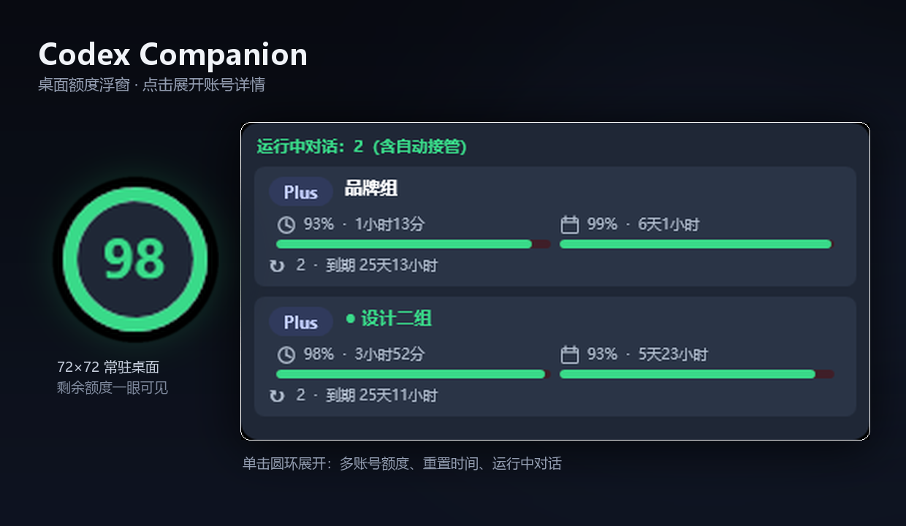
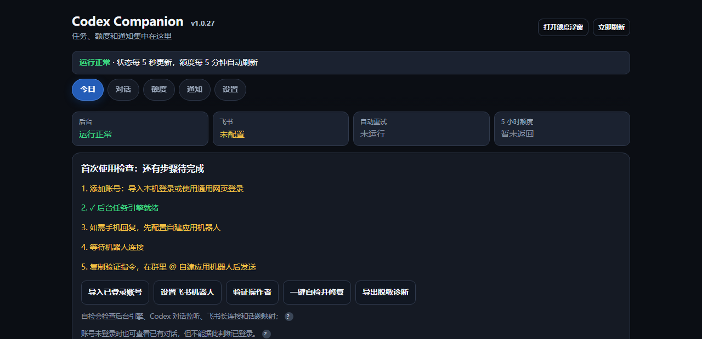

# Codex Companion

**Codex 在跑，你不用守着屏幕。**

任务完成 / 失败 / 等你确认 → 手机飞书立刻收到；在飞书里回一句话 → 原对话接着跑；桌面一个小圆环 → 随时看到额度；多个账号 → 点一下切换；遇到「模型繁忙」→ 自动点重试。

全部在本机运行，账号凭据用 Windows DPAPI 加密，不经过任何第三方服务器。

## 适合谁

**适合**：在 Windows 上使用 OpenAI Codex（CLI 或桌面端），希望任务跑完手机能收到、人在外面也能回话、同时管理多个账号的人。

**不适合**：想找云端服务或图形化外包工具的人——它只在本机运行，数据不出你的电脑（飞书通知内容除外，见 [PRIVACY.md](PRIVACY.md)）。

## 它替你挡掉哪些麻烦

| 你遇到的场景 | 没有它 | 有它 |
| --- | --- | --- |
| 让 Codex 跑一个长任务 | 守着电脑，时不时切回来瞄一眼 | 跑完 / 失败 / 等你确认，手机飞书立刻响 |
| 人在外面，任务卡在「是否继续」 | 只能回家再处理 | 飞书里回一句话，原对话接着跑 |
| 手上有好几个 ChatGPT 账号 | 退出、登录、再退出、再登录 | 浮窗点一下，几秒切完 |
| 不知道这个月额度还剩多少 | 开网页、翻菜单、逐个账号看 | 桌面 72×72 圆环，一眼看到百分比 |
| 早上起来发现「模型繁忙，请重试」 | 手动点重试，任务停在那 | 自动点掉，通知静默汇总不刷屏 |
| 想留个记录给自己复盘 | 截图、复制、整理 | 飞书消息里就是完整结果 |

## 安装（3 步，不用命令行）

1. 到 [Releases](https://github.com/Match-cj/codex-companion/releases) 下载最新的 `CodexCompanion-Setup-v<版本>.exe`
2. 双击安装（Windows 可能提示「未知发布者」，因为项目没买代码签名证书，选「仍要运行」即可）
3. 装完双击桌面「Codex 助手」——桌面出现圆形浮窗就算成功，控制台网页在 `http://127.0.0.1:17841/`

安装包已内置 **Node.js 运行时（v24）** 和 **OpenAI Codex CLI**，**不需要另外安装任何东西**。账号和配置存在 `%APPDATA%\CodexCompanion`，升级不会覆盖。

装完打开的网页控制台长这样：

> 只想日常使用时，**你其实只需要那个小圆环**：看额度、点开切账号、右键打开完整页面。完整页面只在首次配置（导入账号、配飞书）时才需要认真看。

## 核心功能

- **飞书双向**：任务结果推送到飞书，回复通知即继续原对话（需自建应用，向导式配置）；只收通知可用更简单的群机器人 Webhook。
- **多渠道通知**：企业微信（群机器人 / 应用消息）、钉钉、PushPlus、Server酱、Bark、Telegram、Discord、自定义 Webhook。
- **桌面端自动重试**：Codex 弹「模型繁忙 / 重试」时自动按下重试按钮，优先走系统消息通道、不抢鼠标；通知自动静默汇总。
- **额度浮窗**：72×72 置顶圆环，显示当前账号剩余百分比，多账号点击切换（二次确认）、支持预热。
- **多账号管理**：凭据存 Windows 当前用户加密库（DPAPI），网页登录 / 设备码登录双通道，跨电脑加密迁移备份。
- **上下文水位提醒**：快满时提醒并给出现成的交接提示词，只提醒不自动插话。
- **飞书消息收件箱**：收到的飞书消息自动落成本机 Markdown 文件，本机 AI 可直接读取。
- **转发 Windows 通知**（默认关闭）：把其他软件的系统通知按应用白名单转到飞书。

## 安全与隐私

- 默认只监听 `127.0.0.1`，控制接口不暴露到局域网；开启远程访问需显式设置 24 位以上口令。
- 账号凭据用 Windows DPAPI 加密存储，网页不回显任何密钥。
- 卸载、数据位置、通知里会带哪些内容，见 [PRIVACY.md](PRIVACY.md)；漏洞报告方式见 [SECURITY.md](SECURITY.md)。
- 本项目未购买代码签名证书，安装包可能触发 Windows「未知发布者」提示。

## 常见问题

**要自己装 Node.js 吗？**
不用。安装包自带 Node.js v24 和 Codex CLI。只有从源码跑、且包内没有 `runtime` 目录时，才需要自己装。

**它会不会把我的账号或代码传到别处？**
不会。程序只监听本机 `127.0.0.1`，账号凭据用 Windows DPAPI 加密存在本机。唯一对外发送的是你主动配置的通知内容。

**收费吗？**
MIT 开源，免费，可以自己改、自己分发。

**支持 Mac 或 Linux 吗？**
目前只做 Windows（浮窗、DPAPI 加密、UI Automation 自动重试都依赖 Windows 能力）。

**一定要配飞书吗？**
不配也能用：额度浮窗、多账号切换、本机控制台都不依赖飞书。只想要通知的话，用群机器人 Webhook 最省事；想在手机上「回复」任务，才需要自建应用。

**浮窗挡着东西怎么办？**
可以直接拖到任意位置，位置会记住；右键有菜单（打开控制台 / 刷新 / 复位位置 / 退出）。它不会出现在 Alt+Tab 和 Win+Tab 里。浮窗被意外关掉也不用管：后台每 5 分钟自检一次，会自动拉回来。

**会不会偷偷改我的对话？**
只会往你明确的那个对话里追加你发出的内容。切换账号、停止任务、清除数据都需要二次确认。

**怎么彻底删干净？**
卸载时可选「保留账号/设置」或「一并清除 Companion 数据」；也可以手动删 `%APPDATA%\CodexCompanion`。

## 文档

| 想了解 | 看这里 |
| --- | --- |
| 从源码运行、测试、打包 | [docs/DEVELOPERS.md](docs/DEVELOPERS.md) |
| 版本变化 | [CHANGELOG.md](CHANGELOG.md) |
| 长期计划 | [ROADMAP.md](ROADMAP.md) |
| 参与贡献 | [CONTRIBUTING.md](CONTRIBUTING.md) |
| 安全问题报告 | [SECURITY.md](SECURITY.md) |
| 隐私与本地数据 | [PRIVACY.md](PRIVACY.md) |
| 第三方来源与许可证 | [THIRD_PARTY.md](THIRD_PARTY.md) |

如果这个工具帮到了你，欢迎点一个 ⭐ Star；用出问题或有想法，欢迎[提 Issue](https://github.com/Match-cj/codex-companion/issues)。

---

<b>开发者与排查：技术细节都在 docs/DEVELOPERS.md</b>

安装器机制、启动脚本区别、行为细节、命令行参数、安全回归测试，已整理到 [docs/DEVELOPERS.md](docs/DEVELOPERS.md)。README 只保留普通用户需要的内容。

